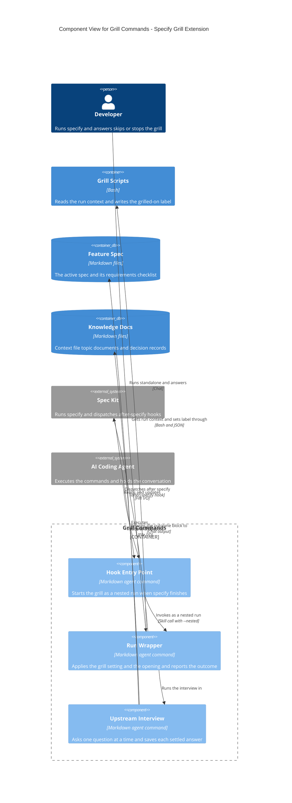
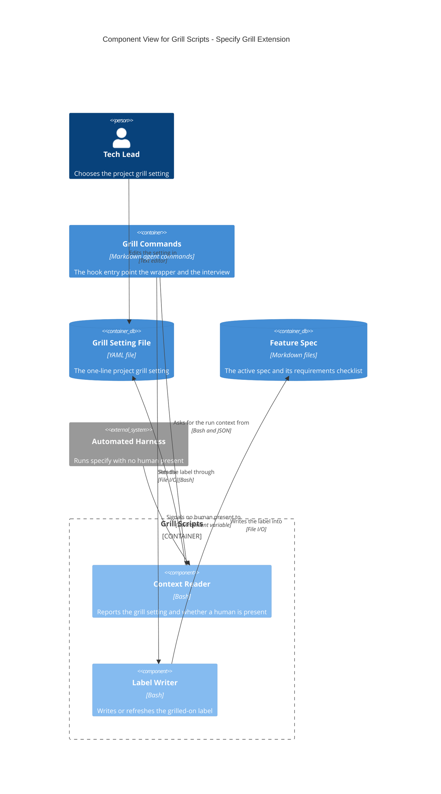
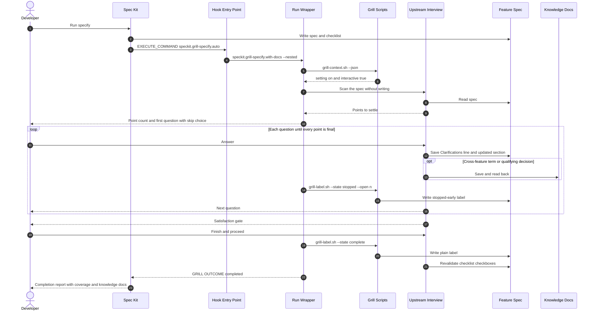
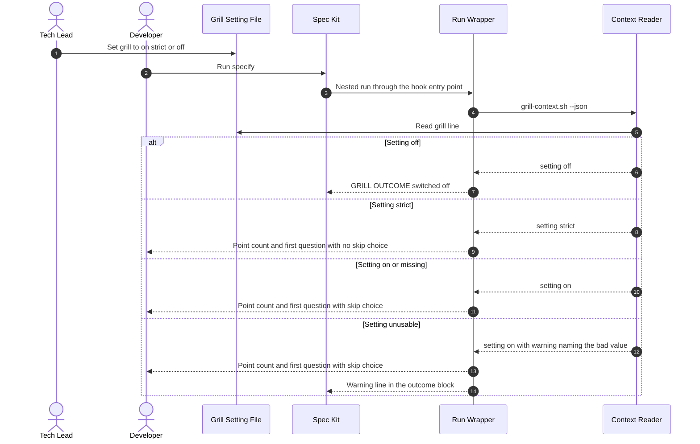
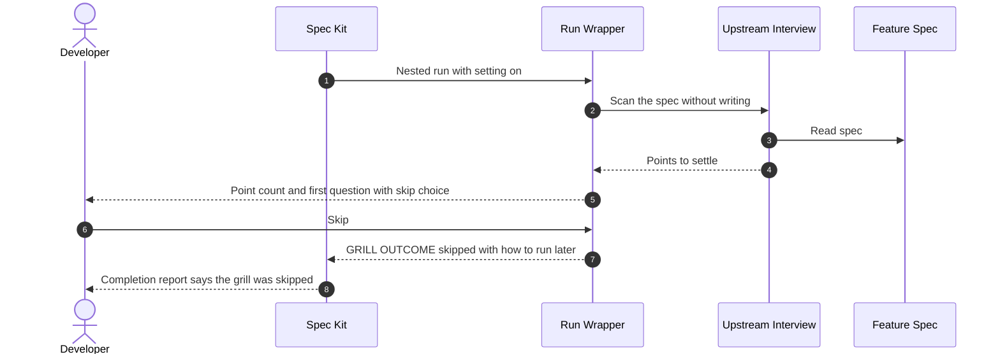
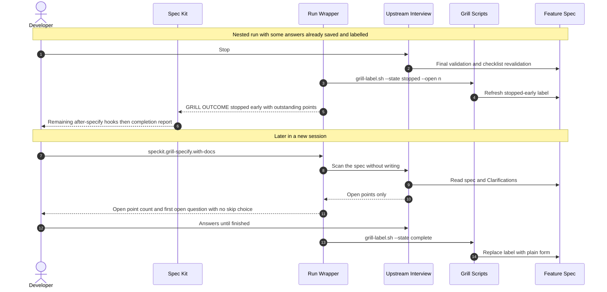
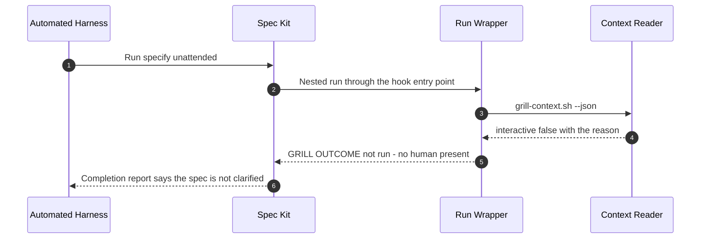
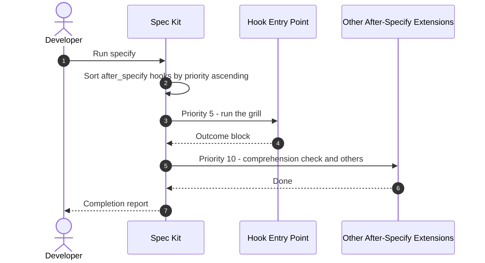
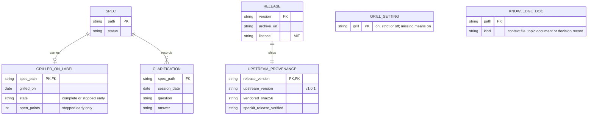

# Architecture: Specify Grill Extension

**Feature**: `001-specify-grill-extension` | **Date**: 2026-10-11
**Feature docs**: [Spec](./spec.md) | [Plan](./plan.md) |
[Data model](./data-model.md) | [Contracts](./contracts/)
**System views**: [Context](../../docs/architecture/context.md) |
[Containers](../../docs/architecture/containers.md) | [ERD](../../docs/architecture/erd.md)
(none of the three exists yet; every element below is new)

## Components

The extension is two containers: the command prompts an AI coding agent follows, and the
Bash scripts those prompts call. The files they read and write live in the project that
installed the extension and are shown as data stores.

### Grill Commands

| Component | Responsibility | Technology | Status | Source location |
|-----------|----------------|------------|--------|-----------------|
| Hook Entry Point | Receives the after-specify dispatch and starts the grill with `--nested`; hands the outcome block back to specify | Markdown agent command | New | `commands/speckit.grill-specify.auto.md` |
| Run Wrapper | Decides nested or standalone, reads the run context, exits when switched off or unattended, presents the opening and skip choice, keeps the label current, prints the outcome | Markdown agent command | New | `commands/speckit.grill-specify.with-docs.md` (outside the upstream markers) |
| Upstream Interview | The with-docs interview from upstream v1.0.1, verbatim apart from the nested-run hook rule | Markdown agent command | New (vendored) | `commands/speckit.grill-specify.with-docs.md` (between the upstream markers); source in `upstream/` |

### Grill Scripts

| Component | Responsibility | Technology | Status | Source location |
|-----------|----------------|------------|--------|-----------------|
| Context Reader | Reads the grill setting with its fallback rules and the non-interactive signals; prints one JSON object; writes nothing | Bash | New | `scripts/bash/grill-context.sh` |
| Label Writer | Inserts or replaces the single grilled-on label under the spec's Status line and changes nothing else | Bash | New | `scripts/bash/grill-label.sh` |

## Flows

### Flow 1: Grill starts automatically and completes (User Story 1)

**Covers**: FR-001, FR-003, FR-011, FR-014, FR-021; US1-AS1 to US1-AS6
**Notes**: Nothing is written between steps 3 and 10. The label is written in its
stopped-early form with the first saved answer, so a session that ends abruptly leaves a
truthful spec. Clarify hooks are not processed in this nested run (FR-006).

### Flow 2: The grill setting decides the start (User Story 2)

**Covers**: FR-005, FR-012, FR-013; US2-AS1 to US2-AS4
**Notes**: The setting is read once per run. A standalone run does not consult it.

### Flow 3: Skip a simple spec (User Story 3)

**Covers**: FR-012, FR-014; US3-AS1, US3-AS2; SC-002
**Notes**: No write happens on this path, so the spec is byte-for-byte what specify
produced and carries no label.

### Flow 4: Stop partway and resume later (User Story 4)

**Covers**: FR-002, FR-013, FR-015, FR-021, FR-023; US4-AS1 to US4-AS4; SC-006
**Notes**: Resume state is only what the spec and knowledge docs hold; there is no
progress file. Stopping ends the grill alone, so specify goes on to its other hooks.

### Flow 5: No human present (User Story 5)

**Covers**: FR-007, FR-014; US5-AS1, US5-AS2; SC-009
**Notes**: Interactivity is checked before the setting, so the result is the same at
`on`, `strict` and `off`. No question is asked and no file is read for writing.

### Flow 6: Ordering among after-specify hooks (User Story 6)

**Covers**: FR-009, FR-016, FR-023; US6-AS2
**Notes**: The order comes from this extension's own registration. No other extension's
registration is read or changed.

## Data

Only stored items appear here. The run context, the grill run, the outcome and the
coverage summary are transient and are described in [data-model.md](./data-model.md).

| Entity | Status | Stored in | Notes |
|--------|--------|-----------|-------|
| GRILL_SETTING | New | Grill Setting File | One line; read textually, never written by the extension |
| SPEC | Existing | Feature Spec | Spec Kit's own artefact; the extension adds the label and Clarifications to it |
| GRILLED_ON_LABEL | New | Feature Spec | At most one per spec, directly under Status |
| CLARIFICATION | Existing | Feature Spec | Upstream's and core clarify's format, unchanged |
| KNOWLEDGE_DOC | Existing | Knowledge Docs | Upstream's rules, unchanged; a Clarifications line may settle entries here, with no stored link between them |
| RELEASE | New | Public repository | Git tag and its archive |
| UPSTREAM_PROVENANCE | New | `upstream/UPSTREAM.md` in each release | Version, hash, licence and update procedure |

## Architecture Impact

| View | Change | Element | Detail |
|------|--------|---------|--------|
| Context | Add | Specify Grill Extension | The system itself: grills a new spec straight after specify |
| Context | Add | Developer | Person; runs specify, answers, skips, stops and resumes |
| Context | Add | Tech Lead | Person; chooses the grill setting |
| Context | Add | Automated Harness | External system; runs specify with no human present and signals it |
| Context | Add | Spec Kit | External system; hosts the extension and dispatches after-specify hooks |
| Context | Add | AI Coding Agent | External system; executes the commands and holds the conversation |
| Context | Add | Upstream Grill Extension | External system; source of the vendored interview, may be installed side by side |
| Context | Add | Other After-Specify Extensions | External system; run after the grill in priority order |
| Containers | Add | Grill Commands | Markdown agent commands: hook entry point, run wrapper, upstream interview |
| Containers | Add | Grill Scripts | Bash: context reader and label writer |
| Containers | Add | Grill Setting File | YAML file holding the one-line setting |
| Containers | Add | Feature Spec | Markdown files: the active spec and its requirements checklist |
| Containers | Add | Knowledge Docs | Markdown files: context file, topic documents, decision records |
| Containers | Add | Grill Commands to Grill Scripts | Gets run context and sets label through, Bash and JSON |
| Containers | Add | Grill Commands to Feature Spec and Knowledge Docs | Reads and updates, File I/O |
| Containers | Add | Grill Scripts to Grill Setting File and Feature Spec | Reads the setting; writes the label, File I/O |
| ERD | Add | GRILL_SETTING, GRILLED_ON_LABEL, RELEASE, UPSTREAM_PROVENANCE | New entities as in the diagram above |
| ERD | Add | SPEC, CLARIFICATION, KNOWLEDGE_DOC | Existing Spec Kit and upstream artefacts, recorded because the extension reads and writes them |
